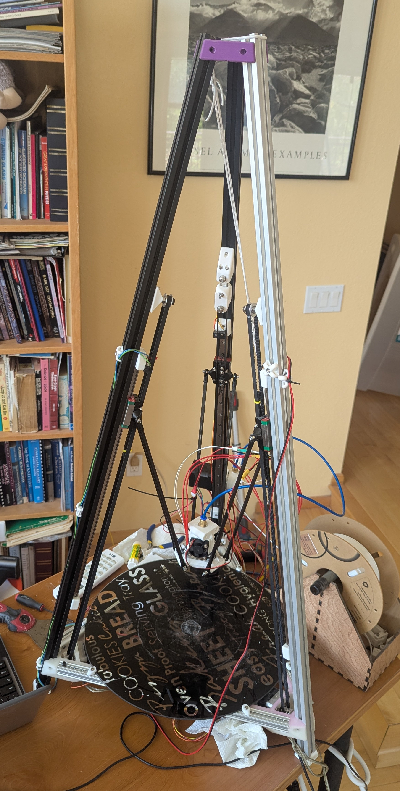

# Tetra3D
#### [Development Notes](https://github.com/Mr-What/Tetra3D/blob/master/doc/Notes/NOTES.md "Tetra development notes")

## Tetrahedral 3D printer

An ideal tetrahedral delta model has all base legs the same length, where the virtual apex of the three
towers meet at a single apex point.
An ideal model would need only 3 parameters, base length, arm length, and apex height.
(include drawing here?)

This model supports each tower having a different tilt with
respect to the base, a different location with respect to the bed center, a different arm length for each tower,
and software defined distance from the bed where each tower
hits it's endstop.
This allows us to calibrate not only for tetrahedral frames,
but we can perform a sloppy build, and reduce the resultant
error by characterizing the actual build parameters,
instead of asserting that the build matches the design perfectly.

### klipper changes

This model is maintained as branch [tilted-delta-kinematic-dev](https://github.com/Mr-What/klipper/tree/tilted-delta-kinematics-dev "fork of klipper") off of the master klipper project.
Clone this branch, and follow the usual klipper build procedure.

The relevant changes and additions are:
   * [tilted_delta.py](https://github.com/Mr-What/klipper/blob/tilted-delta-kinematics-dev/klippy/kinematics/tilted_delta.py "main kinematic changes")  Main kinematic additions.
   * [chelper/kin_tilted_delta.c](https://github.com/Mr-What/klipper/blob/tilted-delta-kinematics-dev/klippy/chelper/kin_tilted_delta.c "inverse kinematics") C version of inverse kinematics, called many thousands of times for path planning.
   * [chelper/\_\_init\_\_.py](https://github.com/Mr-What/klipper/blob/tilted-delta-kinematics-dev/klippy/chelper/__init__.py "list of supported kinematics options") list of kinematic options

The change to ```__init__.py``` is fairly trivial,
add the name ```"tilted_delta"``` to the list of supported
kinematics, and define entry points.

### Contents of Tetra3D

Other code for a delta printer with tilted towers, usually to form a tetrahedron, are in this, Tetra3D project.

One of the goals of this project is to minimize changes
to the klipper project.
Must calibration and analysis are done by reviewing klipper logs.
Typical work flow is to command a ```FIRMWARE_RESTART``` to get the latest configuration recorded in the log,
do your calibration work, then bring the section of the logfile since last restart to your host or desktop for analysis.

  * Analysis utilities are in the ```tools``` folder.
  * Sample configuration files are in the ```doc/KlipperCfg``` folder.

There is a significant amount of work in the form of macros,
which are in the ```doc/KlipperCfg``` folder.
You may want to sync your ```KlipperCfg``` files to
```.../printer_data/config```.

### kinematics overview

A traditional delta printer asserts that all towers
are perfectly perpendicular to the print bed.
This tetrahedral, or tilted, model allows the towers
to have a tilt with respect to the bed.
That tilt can be a calibration for imperfect tower
construction, or allow for novel architecture, like
the tetrahedral frame.



The current model as implemented, can have a real dimensionality of 18.
Base positions (6), tower angles (6), arm lengths(3), and endstop positions(3).

### Calibration overview

Generally, you optimize simple parameters first, from a bed probe.
A typical sequence is:
   1. Guess tower base distance from center, measure arm lengths and endstop distance from bed.
   2. Set all parameter triplets the same as each other, according to design.
   3. probe bed
   4. calibrate delta_radius and endstops.  This is often good enough to print.  Update ```printer.cfg```.
   5. Print HEX_OUTLINE to help you place the calibration plate.
   6. probe plate
   7. probe bed
   8. Perform more detailed calibration.  Update ```printer.cfg```
   9. probe bed.  
   If you are not yet sufficiently calibrated, re-probe the plate, then goto 8.

See
[Tetra Calibration](./doc/Calibration.md)
for details.
