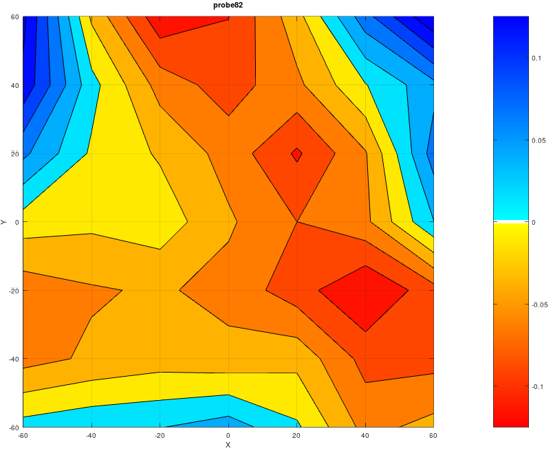

# Tetra3D printer calibration

## New printer

### Guess initial parameters

arm_lengths are usually pretty close to measurement,
on pivot centers.

tilt_radial is usually pretty close to measured, or designed.

tilt_tangential = [0,0,0]

delta_angles = [210,330,90]

delta_radius should start close to where center of carriage arm pivot would hit the bed, if it could go that far, to center
of effector arm pivot when touching the bed.

this should be good enough to collect a bed probe.

### Initial refinements

start with 'R1' to get in the ballpark.
Make sure that your configuration, ```tetraInit.m```,
has settings for your network.
The data load commands will retrieve parts of
```klippy.log```.
```
     cd myDataDir
     td = tetraLoadCalData('myProbeFile.log');
     gp = tetraCal('R1',td,[],1);
```

Next, refine your average arm length.
```
     gp = tetraCal('A1',td,gp,1);
```     
Go back, and get independant delta radius:
```
     gp = tetraCal('R',td,gp,1);
```
Next, do independant arms,
```
gp = tetraCal('R', td, gp,1);
```
Update your ```printer.cfg``` to reflect
the settings in `gp`.
At this point, hopefully, you are calibrated enough
to do a sloppy print.
If not, do a bed mesh and use it.

### Calibration plate probe

Run macros
```
   SET_EXTRUDER_NOWAIT T=230
   SET_PATTERN_SCALE SCALE=70
```
Replace 230 with an appropriate extruder temperature for your filament.\
Change 70 to desired hex radius, center to corner.

Wait for extruder to come to printing temperature,
then ```HOME```, and run ```hex_outline.gcode```.

Glue your plate to the bed with the mark going toward tower C, the +Y direction.

Run the plate probe gcode for your plate.

### Calibration refinements

At this time, I am recommending to avoid trying to optimize
delta radius, 'R', and arm lengths, 'A' at the same time.
They are closely related, and you tend to get **overfits**.
This is where you get non-physical parameters,
that might optimize your error,
but tend to be bad interpolatns/extrapolents for parts
of the print envelope that were not directly measured.

At first, I would also leave the delta angles as designed.
When you optimize these, especially along with delta radius,
you tend to get solutions where the print center
is not close to the center of the print bed.
This leads to overfit.
I can choose a point, near the center of the envelope,
which will have towers at the designed tower angles.
Optimization of tower radius should converge near this point.

If you are using the standard 37 point hex pattern,
plate template C, for now you must set the probe plate pattern.
```
     octave> pattern=hexGrid(3)*17;
```
where the 17 is the spacing between dimple centers.

Then pass the plate pattern to the plate load, 
```
     cp = tetraLoadPlateProbe('plateC141.log', pattern);
```

If you are using a 20mm on center regular grid of dimples,
you need not supply the pattern template:
```
cp = tetraLoadPlateProbe('plate139.log'); % load cal plate probe
```

In either case, combine your plate probe with a bed probe
to collect all necessary calibration data:
```
     td = tetraLoadCalData('probe136.log',cp); % combine with bed probe
```

Then you can proceed with calibration,
```
     gp = tetraCal('RZT', td, [],2); % radius and tower tilt
```
You may want to keep a copy of the last set of **good** parameters
in case you get an over-fit later,
```
% copy in case one of the refinements seems outlandish, and you want to re-try
igp = tetraExtractCfgParams(gp);

gp = tetraCal('AZT', td, igp,2); %   arms and tower tilt
```
Repeat the ```'RZT'``` and ```'AZT'``` calibrations, feeding ```gp``` back,
until the changes are negligible.

Update your ```printer.cfg```, repeat your plate and bed probes,
then repeat the above procedure until changes are negligible.

If they oscillate, We should add a flag to tetraCal to
start every tetraRefine with the best guess so far,
and, only then, do a RPAZT.
If it is not near the average of AZT and RZT results,
be cautious of an overfit.

## Recommended calibration procedure

  1. check and update probe offset
  2. ```FIRMWARE_RESTART```, then run bed probe, ```radialBedProbe.gcode```
  3. copy results to ```octave``` machine,
  ```
       > td = tetraLoadCalData('probe007.log'); % tetra data
  ```
  This will fetch bed probes after the most recent
  initialization to the current time, and store them in 
  ```probe007.log```.
  4. calibrate ```delta_radius``` with the same value for each tower, and endstops.
  ```
       > gp = tetraCal('R1', td);
  ```
  5. update ```printer.cfg``` on RPi host:
  ```
       update_klipper_cfg.py printer.cfg updateYYMMDDHHMMSS.cfg
  ```
  6. This is all the calibration that was typically done by hand on old delta printers.
  Check your bed levels with another bed probe, or compute the bed mesh with:
  ```
       HOME
       BED_MESH_CALIBRATE PROFILE=R1
       SAVE_CONFIG
  ```
  7. I prefer to do the calibration prints without the bed compensation, which will have a residual error in the calibration computations.
     If you need the compensation to print, you can try
  ```
     > gp = tetraCal('A1', td, gp.p);
     > gp = tetraCal( 'R', td, gp.p);
  ```
   Update those parameters, using the endstop positions from the last calibration computation.

  8. **[DEPRICATED]** print the calibration print, ```deltaCalPrint60.gcode```, which is sliced from ```Drawings/deltaCalPrint.scad```.
  9. **[DEPRICATED]** Measure the calibration print.  Alter the 
     ```Tetra3D/tools/test/deltaMeasTemplate10_60.m``` file.
     The first two letters should match the measured hexes.
     The ```i``` suffix is for the distance between interior edges of the hex pair.
     The ```o``` suffix is for the outside edge distance.
  10. At this time, your printer should be sufficiently calibrated to print.  Use a bed mesh compensation if necessary.
  11. run ```HEX_OUTLINE R=83``` for the radius of your calibration plate.  Plate radius is measured from center to a corner.  You may want an outline about 2mm larger than your measurement to give room for miscalibration.
  12. switch back to a probe, and glue your calibration plate to the bed.  UHU glue sticks are recommended, but Elmers is fine.
  13. ```FIRMWARE_RESTART``` and run a calibration plate probe.  ```probePlateC.gcode```.  The restart should get rid of any bed mesh that was loaded to print the hex.
  14. Load it
```
    > cp = tetraLoadPlateProbeFromLog('probe008.log');
```
  15. Remove the calibration plate, clean the bed, and run another bed probe using the same parameters loaded for the calibration plate.
  16. Load the calibration plate data, and merge it with the latest bed probe:
```
     > cp = tetraLoadPlateProbeFromLog('probe008.log');
     > td = tetraLoadCalData('probe009.log', cp);
```

  17. **[DEPRICATED]** I am no longer recommending a full cal.  I had it work well a few times, but it often overfits.  ~~Run the full calibration:~~
  ```
       > gp = tetraCal('RPAZT',td);
  ```
  18. It is recommended to start with some reduced parameter calibrations to obtain a calibration with values fairly close to the physical values.
I am trying to leave the delta_angles at nominal.
It seems like refining them is likely to lead to an over-fit.
Note that for any set of tower positions, I can choose
a bed center such that those towers are at the standard delta angles.  
A recommended sequence might be:
    <pre><code>&gt; gp = tetraCal( 'A1', td);        % single arm length
     &gt; gp = tetraCal( 'R1', td, gp.p);  % single delta_radius
     &gt; gp = tetraCal('RZT', td, gp.p);  % tower pos and tilt
     &gt; gp = tetraCal('AZT', td, gp.p);  % arm len and tilt
    </code></pre>
    If repeated RZT and AZT fail to converge,
    try refining arm length (and endstop) alone,
    with tower position and tilt updates,
    <pre><code>&gt; gp = tetraCal(  'A', td, gp.p);
    &gt; gp = tetraCal('RZT', td, gp.p); 
    </code></pre>
    Note that **endstop updates are ALWAYS computed** in
    ```tetraCal()```.
    
  18. Update ```printer.cfg``` with these results.
      Delete any previous bed meshes in ```printer.cfg```.
      They are no longer valid after calibration parameters have changed.
      
  19. Check with another bed mesh, or probe script.
      I usually find that if the probed level is mostly within [-0.1,0.1] that is good enough to print, and don't worry about a bed mesh correction.

After re-calibration, bed mesh was:

